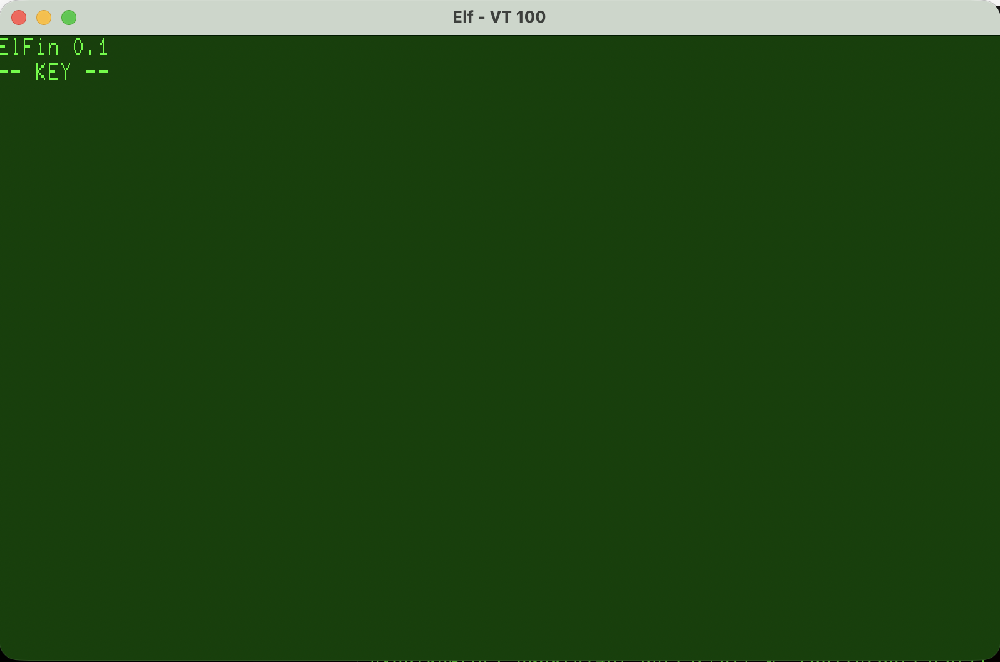
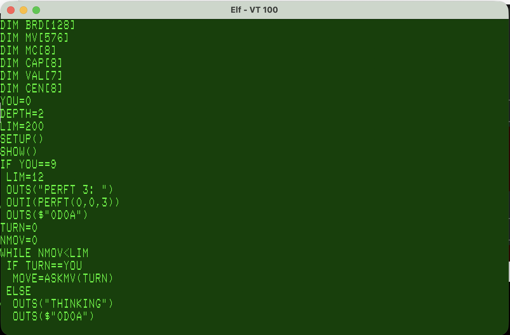
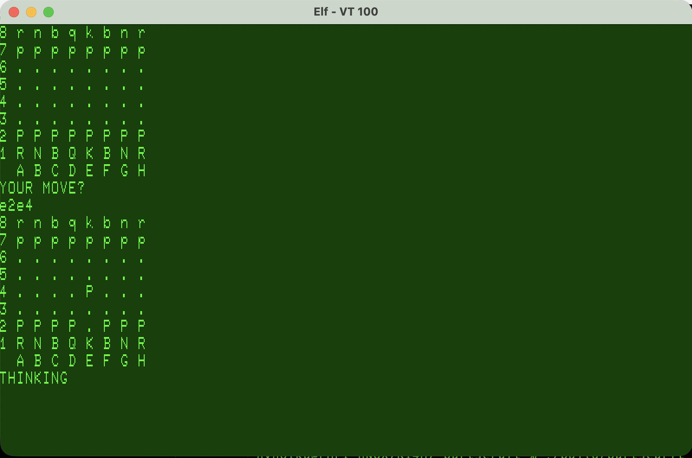

# Getting Started

## Running with Emma 02 emulator

First you need to install Emma 02 of course.

Then depending on your platform use one of the following from the command line:

### macOS and Linux

```
./emma.sh images/chess.hex                 # on a 32K Elf
./emma.sh images/chess.hex mini            # on an 1802/Mini
CLOCK=100 ./emma.sh images/chess.hex       # at 100 MHz, quicker for editing
```

### Windows

```
emma.cmd images\chess.hex
emma.cmd images\chess.hex mini
emma.cmd images\chess.hex -Clock 100
```
From PowerShell, .\ is needed in front of the script:

```
.\emma.cmd images\chess.hex -Clock 100
```

How the Emma machines are set up, how to build and run your own programs on
them, and what cannot be tested there is in [asm/emma/README.md](asm/emma/README.md).


## Running on real hardware

The prerequisite are:

* CDP1802 CPU
* At least 32k RAM at 0x0000
* CDP1854 UART at input/output ports 6 and 7
* VT100 terminal (with hardware handshake)

The  UART card's TX HANDSHAKE and RX HANDSHAKE jumpers must be on EN, and the terminal set to RTS/CTS flow control (it works with the handshake disable but typing too fast will cause problems).

### elf/OS

You need elf/OS of course.

Then you need to copy `images/chess.elfos` to your system and then you can execute it as any elf/OS executable. The executable copies the code over the OS at 0x0000 and runs from there using its embedded terminal I/O directly using the UART.

###  without OS

You need to do what ever it takes to load `images/chess.hex` to address 0x0000 and execute the code from there.

## What to expect

ElFin should come up with screen like this:




Type any key and you enter the editor and see the source code.

 

To run the code you type *CTRL-R*

 

To load or save the program use *CTRL-L* and *CTRL-S* assuming you have provided those routines in the image.

*CTRL-E* clears the memory and allows starting a new program; it asks `CLEAR? Y/N` first.

You can edit the source code on the screen with cursor keys.

The editor is slow and if you do not have hardware handshake with the terminal serial connection the screen may get corruped. To refress the screeen use *CTRL-W*.

The editor's control keys:

| key | what it does |
|---|---|
| CTRL-R | compile and run the program; a key afterwards brings the editor back |
| CTRL-S | save the program, as text, through the storage driver |
| CTRL-L | load a program's text, adding its lines after the last one |
| CTRL-E | clear the program, after asking `CLEAR? Y/N`; only `Y` clears it |
| CTRL-B | mark a block of lines: press it on the first line, move to the last, press it again to move the block |
| CTRL-D | instead of the second CTRL-B: duplicate the marked block |
| CTRL-W | refresh the screen: reset the terminal and repaint everything |
| CTRL-Q | start again: the welcome screen, a key, then the editor |

After the second CTRL-B or a CTRL-D, move to the line the block is to go
above and press Enter; any key but the cursor keys and CTRL-W cancels.
Backspace and Delete delete, and
at the start or end of a line join it to its neighbour; Enter splits a line.
The full description is in [SYNTAX.md, "The editor"](SYNTAX.md#the-editor).


## Configuring for different hardware

### Memory size

ElFin itself takes `$0000`-`$64FF`. Your program, its variables and its names
live in the program store, from `MEM_LO` to `MEM_HI`, two little-endian words in
page 0:

```
$0003   MEM_LO   where the store starts     $6500
$0005   MEM_HI   where it ends, plus one    $8000 in images/chess.hex
```

`images/chess.hex` is built for 32K: its store is `$6500`-`$7FFF`, 6.75 KB,
and it runs on any machine with at least 32K of RAM from `$0000`. Chess
without its comments needs about 5.2 KB of that. On a bigger machine the RAM
above `$8000` is simply unused, and free for your own machine code.

To give a program more room, build the image for the machine's RAM:

```
RAM=48 ./make-image.sh src/elfin/chess.txt images/chess48.hex   # store to $C000, 22.75 KB
./make-image.sh src/elfin/chess.txt images/chess60.hex          # store to $F000, 34.75 KB
```

`RAM=` takes 32 to 64; the store never goes above `$F000`, where the 1802/Mini
has its ROM. Without `RAM=` an image is for 60K, the Mini's RAM.

Patching `MEM_HI` in an image does not move its store at once: the image's
store was set up when it was built, with the program in it. ElFin reads
`MEM_LO` and `MEM_HI` again on Ctrl-E, which clears the program. So patch, then
Ctrl-E, then load or type the program; or build the image for the RAM, as
above. [MACHINE.md](MACHINE.md#setting-the-memory-size) has the table and the
rest.

### A different UART

Everything ElFin sends to or reads from the terminal goes through three
vectors in page 0. Each is a little-endian word holding the address of a
routine:

```
$000D   PUTC     write the character in D
$000F   GETC     wait for a character, and return it in D
$0011   KBHIT    D nonzero if a key is waiting, without waiting
```

The editor, the compiler's messages and a running program's `PUTCH`, `GETCH`
and `KEYHIT` all come through these, so a new terminal is three routines.

**The calling protocol.** A routine is entered with `SEP RF` from code running
on R3, with X on R2 and, for `PUTC`, the character in D. It returns with
`SEP R3`, with its answer in D: the character for `GETC`, nonzero or zero for
`KBHIT`, and for `PUTC` the character it was given, which is what `PUTCH(C)`
returns. It may use D, DF, X, RE, RF and the byte at M(R2), and nothing else.

Two things follow from that:

- **RF is the routine's program counter**, because it was entered with
  `SEP RF`, so it cannot be a pointer: use RE. The byte at M(R2) is the usual
  place for `OUT` and `INP`: `STR R2` / `OUT n` / `DEC R2` sends D, since `OUT`
  advances R2.
- **There is no set-up call.** ElFin was loaded through the terminal, so it
  expects the UART to be ready. A driver that needs setting up can keep a flag
  and do it on its first call.

**Where to put the code.** There are two ways:

1. **In ElFin, and build again.** The routines are `DRV_PUTC`, `DRV_GETC` and
   `DRV_KBHIT` in `asm/elfin/main.s`, in the `MINI` part, with the ports
   `UDATA` and `USTAT` at the top of that file. Change them, and
   `./make-image.sh` builds an image whose vectors already point at them. This
   is the way for a permanent driver, and for the `.elfos` executable, which
   carries the image as it was built.
2. **Patch an image.** Put the routines in RAM ElFin does not use, above
   `MEM_HI` - from `$8000` with `images/chess.hex` on a machine with more than
   32K - and write their addresses into the three vectors before starting
   ElFin. Nothing else needs to change.

The routines that are there now drive a CDP1854 on ports 6 and 7, with the
1802/Mini serial card's handshake. They are the example to follow:
[MACHINE.md](MACHINE.md#terminal-io-for-the-on-screen-editor) describes them,
and the handshake.

### Saving and loading

Ctrl-S and Ctrl-L save and load the program as plain text through one more
vector in page 0, `STORAGE` at `$001B`, and a driver for your tape, paper tape
or serial line goes behind it. Out of the box there is no driver, and both keys
report `ERR 32`. The hook, its operations and a tape driver's timing are in
[MACHINE.md, "Saving and loading programs"](MACHINE.md#saving-and-loading-programs).
