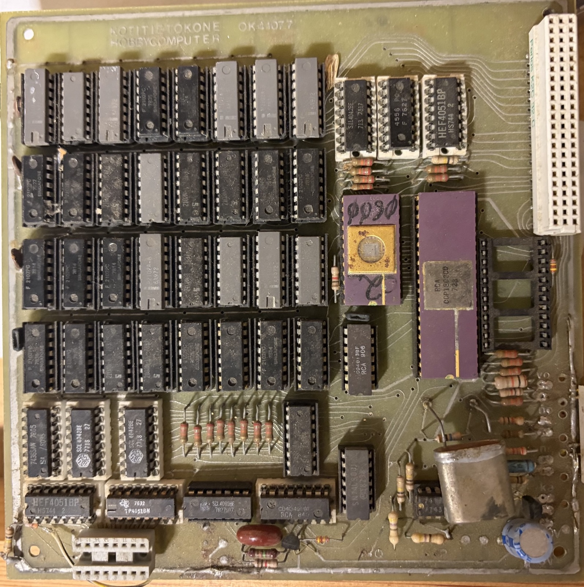
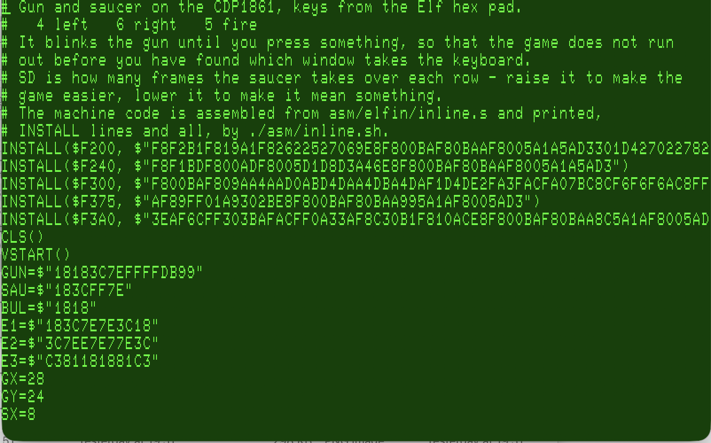

# ElFin - A Nostalgic Language That Never Was

At around age of fifteen I begged, borrowed and stole parts for my first computer that was a Finnish knock-off of COSMAC VIP called Telmac which had 4 kB RAM later expanded to 12 kB with a 64 column by 16 line character display.


I had Tiny BASIC for it and a floating point BASIC was also available though I never had that.

In a few years that computer and other 8 bit CPU based computers were all but gone.




*For an other nostalgic project see my article on [PICOSMAC](https://www.nutsvolts.com/magazine/article/picosmac-back-to-the-past) in Nuts & Volts which has its own github repo here 
[here](https://github.com/nyholku/picosmac).*

### Wishful thinking now and back then

Now, closer to fifty years later I got thinking what I could have created in those few precious years around 1980 if I had had the knowledge and experience I have today.

Back in the day it would have been great to have a compiled high level language like Pascal.

I actually got around to implementing a Tiny Pascal compiler from a Byte magazine article for TRS-80 around that time. Tiny Pascal is great but basically demands better mass storage than a single C-cassette tape recorder because there simply was not enough RAM to keep the compiler and the source code nor the compiled code in memory at the same time.

Perhaps with dual cassette recorders and hardware to pause them on demand this could have been achieved. But it would not have been very convenient: load editor into RAM, edit source code in memory (memory permitting), save the code into cassette, load compiler into memory, rewind both decks, start the compiler, press play on one deck and record on the other (to store the compiled code), wait ages for the compile to finish, load the compiled code and debug, ad nauseam.

The interactive nature of BASIC and the immediate dopamine rush when you RUN the code is what drew many people to computers. The downside of BASIC is that it was interpreted and slow.

ElFin started its life around 2025 as tokenizing pre-compiling BASIC. But as soon as I got it running I felt that it was not worth it.

Edsger Dijkstra famously wrote an essay called "BASIC considered harmful". While I strongly disagree with his opinion on that, I felt that my 'little bit better' Tiny BASIC was seriously lacking.

Twenty seven variables, no local variables, GOTO/GOSUB by line numbers etc.

Especially the line numbers bothered me as they waste a quite a lot of memory, most of them being used only to identify a line when you replace it.

So I got to thinking about something like Quick BASIC. Let the thought run free for a while and you soon realize that that Python (which I dislike!) has one of the most compact syntaxes for a structured imperative programming language.

Throw away the redundant colon wart and strip the language to bare minimum and we have a nice little language model for 8 bit computers.

**Hence ElFin[^1] was born!**

### A could have been language

[^1]: (The original name was NotPy but that is so not 1978, ElFin instead is kind of word play that I could have come up back then bein a Fin and the connection Elf and elfin in English meaning small, delicate, a bit magical. Or in Spanis 'the end', signalling that it is the last language you need.)

My main goal in designing ElFin was to have the execution speed of a compiled language with the interactive nature and speed of an interpreted language in a kind of imaginary 1980 hardware with no disc storage and limited memory.

To achieve this the source code is always kept in memory tokenized with embedded space holders for things like branch addresses.

In this way source code becomes the compiled code and vice versa!

A syntactically correct source code can be always converted to tokenized source code and back verbatim. 

The in-memory format of the source code  is documented in [STORED-FORM documentation](STORED-FORM.md)

To further save space all symbols (variable and subroutine names) are only stored once and the tokenized code only stores references to the symbol table. Therefore the symbol table is an integral part of the source code.

### With an on screen editor

Because ElFin ditches the line numbers an on screen editor is almost mandatory so it is integrated to ElFin.

The tokenized form of the source code lends itself nicely to a gap buffer editor where all the text being edited is in two blocks: text before the cursor position is at the beginning of the buffer and text after the cursor is packed to end of the buffer leaving a gap where inserting and deleting text can be done without moving large number of characters.

Here is what it looks like when run on Emma 02 1802 emulator and its built in VT100 terminal emulator.



One sub goal I had in mind that ElFin should make it possible to write CHIP8 like games with CDP1861 graphics. And indeed, it is possible by embedding the video interupt routine in the ElFin code:


### Key properties of ElFin

This is a compiled language which is the *raison d'etre* for it.

Compilation happens while you edit the code, it is not a separate step.

All access to local and global variables is via offsets/address computed at compile time. 
 
All control structures use pre computed branch instruction under the hood. 

There is no name look up for symbols (variables, function names, keywords) at run time.

The language supports recursion and local variables with long names.

The block structure of the code is based on indentation not unlike in Python.

All variables and arithmetic is signed 16 bit.

One dimensional arrays can be defined with DIM statement.

You can call machine language routines and embed the hex code for them in an ElFin program,


### Syntax

You can see the syntax of ElFin here [SYNTAX.md](SYNTAX.md)

But here is some ElFin code to get you a taste of the language:

```
# count to ten
I = 1
WHILE I <= 10
 I = I + 1
```

Define a subroutine:

```
DEF MAX(A, B)
 IF A > B
  RETURN A
 RETURN B
```

### Demos

To demostrate the capabilities of the language I told Claude to write a chess playing program in ElFin. You can browse it here: [src/elfin/chess.txt](src/elfin/chess.txt). It is best described as 'it works' but servers the purpose of demonstrating the language. 

The [src/elfin/eightqueens.txt](src/elfin/eightqueens.txt) is an other chess demo solving the eight queens problem.

An other mildly interesting demo is [src/elfin/gunner.txt](src/elfin/gunner.txt) which is a skeleton of a CHIP8 like game that could work with a machine with 1861 chip.

Two more snippets that someone might find useful are [src/elfin/sierpinski.txt](src/elfin/sierpinski.txt) and [src/elfin/sprites.txt](src/elfin/sprites.txt).


### Language I/O

ElFin has not I/O in the language itself, always a though call for any language designer. Instead you need to provice your own I/O and embed some machine language stubs to your ElFin program like chess does.


The thinking behind this decision was that I don't want to burden the language itself with something that the user might not need. Instead the language should enable any I/O the user needs and ElFin does this by allowing you to embed and call machine language routines and providing hooks to terminal I/O so it is trivial to do that if that is what you need.

The on screen editor obviously needs some I/O and this effected by built in hooks on the zero page and you can utilise them like this:

```
OUTS("HELLO WORLD!")
DEF OUTS(S[]) $0017
```

For more complex examples see the chess program source code. To see how to embed machine language and the CDP1861 video interrupt see the gunner source code.


### P-code

The editor and compiler fit in 32kB RAM with some room for ElFin programs. To make that possible they are implemented in P-code for a stack based machine and ElFin embeds a virtual machine for this.

The P-code is documented in [PCODE documentation](PCODE.md)


### Getting started 

To get started you need a 1802 machine with atleast 32 kB RAM. Or you could use an emulator, like Emma 02.

See [Getting Started](GETTING-STARTED.md)

### Future plans

As it is today ElFin is kind of slow though it is an order of magnitude (x 30) faster than Tiny BASIC.

I'd be happier if it was enpar with CHIP8 for similar tasks and if it could fit in 16 kB RAM.

However as stated in the beginning this is a "what could have been" nostalgic project I do not see any real need for this so I have no plans to take this further atm so I'm just publishing it here for other old farts like me to enjoy (or not). 

### License

I am licensing this under the GNU General Public License, version 3 or (at your option) any later version - see [LICENSE](LICENSE). In case someone wants to have other license I am happy to consider that.


### Building from source

The images in `images/` run as they are. To build them yourself, run the tests or change ElFin, you need a Java JDK, the AS macro assembler and a few tools: [BUILDING.md](BUILDING.md) says what and how.

### Created with the help of AI

ElFin was originally hand coded in Java (the onscreen editor and the compiler) and 1802 assembly code (P-code interpreter). That turned out to be too tedious to complete for a  project which really had no purpose and was basically just a trip down the memory lane. 

But then I got the idea that this might be a good test case to see how good AI coding and especially Claude Code would be for this kind of task. The end result was that some 90% of the code or more is now AI coded. Also a lot of the documentation is AI generated.

